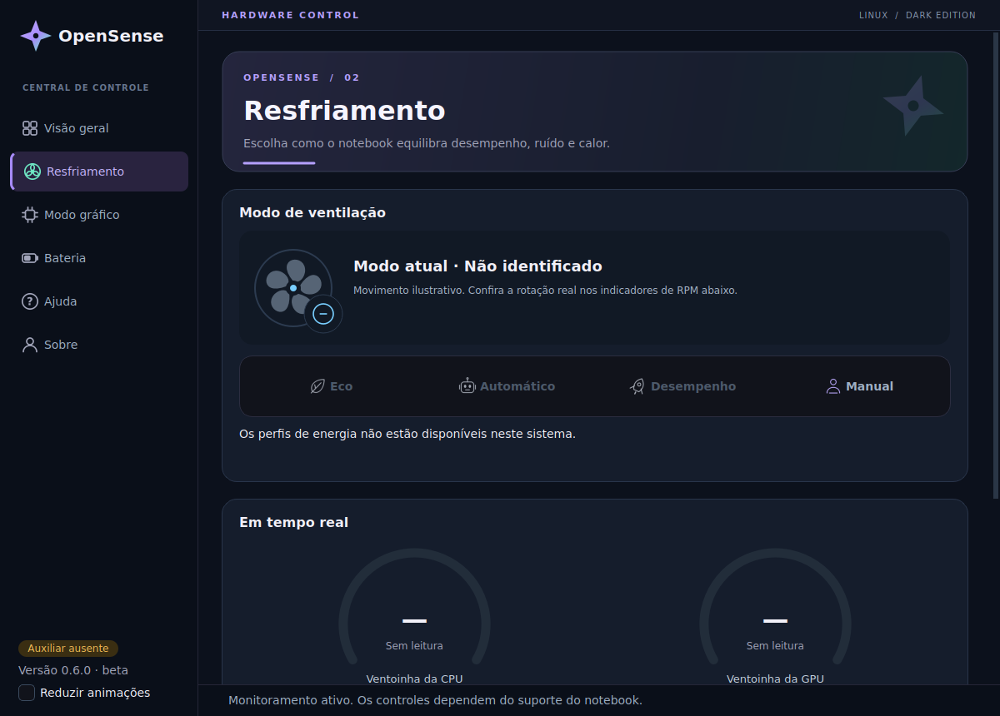

<p align="center"></p>

# OpenSense

**Mais controle sobre o seu notebook Acer no Linux.**

Aplicativo nativo em C++17 e Qt 6, com interface exclusivamente dark, monitoramento, controle de resfriamento, modos gráficos e proteção da bateria. Independente do KDE Plasma.

**Versão 0.6.0 · beta · projeto independente, sem vínculo oficial com a Acer.**

> O suporte depende do modelo, do kernel e dos drivers. O módulo incluído é específico para o **Acer Nitro ANV15-51**, com funcionamento relatado em **7.3.0-4-cachyos**. Não é um driver universal para notebooks Acer.

[Instalação](docs/INSTALACAO.md) · [Compatibilidade](docs/COMPATIBILIDADE.md) · [Driver DKMS](drivers/README.md) · [Contribuir](CONTRIBUTING.md) · [Publicar no GitHub](docs/PUBLICAR_NO_GITHUB.md)

## Por que o OpenSense existe?

O projeto nasceu de uma dificuldade que encontrei ao usar meu notebook Acer com Linux: não tive o suporte que esperava para controlar as ventoinhas, gerenciar a bateria e acessar recursos importantes do equipamento.

Decidi reunir esses controles em uma ferramenta simples, leve e agradável. O que começou como uma solução para meu próprio notebook se tornou um projeto que quero compartilhar com outras pessoas que enfrentam dificuldades semelhantes. A proposta é dar mais autonomia ao usuário, respeitando os recursos realmente disponíveis no hardware e nos drivers.

— Gabriel Renan

## Recursos

| Área | Recursos | Dependência |
| --- | --- | --- |
| Resfriamento | Eco, Automático, Desempenho e Manual de 25–100% | Interfaces compatíveis de perfil térmico e/ou PWM |
| Monitoramento | Temperatura, uso, memória e RPM | Sensores expostos pelo Linux |
| Bateria | Carga, saúde estimada, ciclos e proteção de 80% | Dados de power_supply e interface de limite de carga |
| Modo gráfico | Desempenho (híbrido) e Economia (integrado) | EnvyControl instalado; exige reinício |
| Interface | Tema dark, shuriken, animações e aba Sobre | Qt 6; opção Reduzir animações |

As animações são ilustrativas; não representam a rotação física. A saúde da bateria é uma estimativa do controlador. O controle Manual verifica a temperatura ao aplicar, mas não oferece supervisão térmica contínua. Modo híbrido não equivale a manter a GPU dedicada sempre ativa.

## Interface



*Captura real do aplicativo em ambiente de teste sem sensores Acer. “Sem leitura” e controles indisponíveis refletem esse ambiente.*

[Ver bateria](preview/bateria.png) · [Ver aba Sobre](preview/sobre.png)

## Começar no CachyOS / Arch

Na pasta do projeto, após instalar as dependências descritas no [guia](docs/INSTALACAO.md):

```bash
bash install.sh --app-only
opensense
```

Essa é a opção para atualizar a interface mantendo o driver existente. Instala também os auxiliares e a política Polkit, sem regenerar initramfs.

**Precisa instalar o driver pela primeira vez?** Leia [compatibilidade](docs/COMPATIBILIDADE.md) e [drivers/README.md](drivers/README.md) antes de usar `bash install.sh --driver-only`. A instalação completa sem argumentos também tenta instalar o driver no modelo compatível.

## Permissões

O aplicativo gráfico roda como usuário normal. Operações privilegiadas passam por auxiliares com comandos permitidos explicitamente. A política de resfriamento permite ajustar ventoinhas e perfil térmico Acer sem senha para **qualquer usuário em sessão local ativa**. Não concede acesso genérico como root. GPU e bateria mantêm autenticação; perfis via power-profiles-daemon seguem a política do sistema. Veja [segurança](SECURITY.md).

## Desenvolvimento

```bash
cmake -S . -B build -DCMAKE_BUILD_TYPE=Release
cmake --build build --parallel 2
ctest --test-dir build --output-on-failure
./build/opensense
```

Os testes verificam o núcleo, o escopo do auxiliar e a interface offscreen. Não testam o hardware nem instalam o módulo. O fluxo GitHub Actions incluído compila o aplicativo e executa esses testes; sua primeira execução no GitHub ainda precisa ser confirmada.

## Documentação

- [Instalação e remoção](docs/INSTALACAO.md)
- [Compatibilidade e limites](docs/COMPATIBILIDADE.md)
- [Arquitetura](docs/ARQUITETURA.md)
- [Solução de problemas](docs/SOLUCAO_DE_PROBLEMAS.md)
- [Histórico de versões](CHANGELOG.md)
- [Validação realizada](VALIDACAO.md)
- [Créditos e licenças](NOTICE.md)

## Criador

**Gabriel Renan Silva Martins Guimarães** — estudante de Engenharia da Computação na UFRPE/UABJ, em Belo Jardim.

[GitHub](https://github.com/GabrielRenanPE) · [LinkedIn](https://www.linkedin.com/in/gabrielrenan-computer-eng/)

## Licença

OpenSense é distribuído sob **GPL-2.0-or-later**: GNU GPL versão 2 ou, a seu critério, qualquer versão posterior. Consulte [LICENSE](LICENSE) e [NOTICE.md](NOTICE.md). Direitos e avisos dos componentes de terceiros são preservados. O driver deriva de `acer-wmi` do Linux e de uma adaptação baseada no patch de Justin Vargas; não foi escrito integralmente pelo OpenSense.
